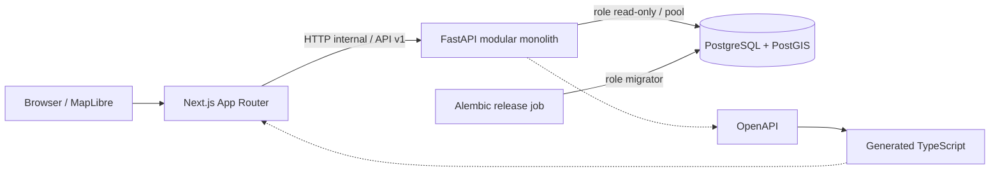

# Arsitektur fondasi WebGIS Merah Putih

Status: keputusan awal, 20 September 2026. Cakupan implementasi: fondasi yang dapat
dijalankan dan diuji; belum merupakan layanan nasional yang siap diluncurkan.

## Kebutuhan dan batas fase

Platform akan berkembang menjadi pemetaan koperasi, monitoring, potensi ekonomi
desa, analitik, dan dukungan keputusan. Fondasi harus menjaga konsistensi data
spasial, kepemilikan aturan bisnis, kontrak API, dan jalur operasional sejak awal.
Fase ini hanya menyediakan shell antarmuka, peta, pembacaan titik berdasarkan
viewport, skema awal, migrasi, kesehatan layanan, pengujian, dan kontainer.
Tidak ada AI, marketplace, dashboard statistik, autentikasi semu, atau data resmi
yang direkayasa. Basis data baru sengaja kosong.

## Bentuk sistem

- Monorepo `apps/web`, `apps/api`, `packages/contracts`, `infra`, `docs`, `scripts`.
  npm workspaces dan uv cukup; belum memerlukan Turborepo, microservices, Redis,
  broker, Kubernetes, atau generic repository abstraction.
- Next.js App Router + TypeScript strict, Tailwind CSS dan komponen shadcn/ui
  lokal. MapLibre hanya berjalan di browser dan dibersihkan saat unmount.
  Worker ESM MapLibre dan shared module disalin saat prebuild/predev ke aset
  same-origin berversi; URL worker eksplisit menghindari kegagalan bundling Next.js.
- FastAPI modular monolith. Modul domain memiliki model, schema, repository, dan
  router sendiri. Lapisan service ditambahkan ketika aturan bisnis membutuhkannya.
  SQLAlchemy 2 + psycopg menggunakan request-scoped synchronous session; endpoint
  database berjalan pada thread pool FastAPI, bukan memblokir event loop.
- PostgreSQL 18 + PostGIS 3.6, SQLAlchemy/GeoAlchemy2 dan Alembic. PostgreSQL adalah
  satu-satunya sumber kebenaran. Tidak ada salinan data di frontend.
- Next.js meneruskan hanya endpoint GET yang diizinkan melalui origin yang sama.
  Alamat internal API adalah environment runtime server, tidak disematkan ke
  browser saat build. Browser tidak mengetahui credential database.
- OpenAPI dari FastAPI diekspor secara deterministik dan menghasilkan tipe
  TypeScript. CI memeriksa drift agar kontrak frontend/backend tidak ditulis dua kali.

## Data dan WebGIS

- Tabel awal `cooperatives`: UUID, nama, kode desa opsional, titik lokasi, sumber
  data, waktu pembuatan. Tidak menyimpan NIK, rekening, telepon pribadi, atau data
  sensitif. Hanya data yang layak dipublikasikan boleh masuk tabel fase ini.
- Impor publik melalui CLI migrator memakai manifest sumber, versi, lisensi,
  penanggung jawab persetujuan, hash CSV, dan ID eksternal unik per rilis. Hanya
  rilis aktif yang tampil; penggantian rilis atomik dan riwayat tetap tersimpan.
  Validasi kode wilayah resmi masih membutuhkan sumber referensi yang disepakati.
- `geometry(Point, 4326)`, urutan GeoJSON **longitude, latitude**, indeks GiST,
  constraint koordinat dan titik nonempty. Tanggal menggunakan UTC/timestamptz.
- API `/api/v1/cooperatives` mengharuskan bbox valid dan limit maksimum 1.000.
  Query memakai ST_Intersects/ST_MakeEnvelope dengan parameter SQL. Hasil diurutkan
  konsisten, mengambil limit + 1, dan menyatakan `truncated` secara eksplisit.
  Tidak ada pengambilan seluruh data nasional atau COUNT(*) pada setiap gerak peta.
- Bbox antimeridian ditolak eksplisit; tampilan Indonesia dibatasi pada wilayah
  yang tidak melintasinya. Kontrak dapat diperluas bila wilayah lintas batas perlu.
- Peta membatalkan fetch usang, memberi status loading/empty/error/truncated,
  dan membedakan kegagalan basemap dari kegagalan data koperasi.
- Basemap demonstrasi eksternal hanya untuk pengembangan; bukan batas resmi
  pemerintah. Sebelum produksi, pilih penyedia berlisensi/SLA atau host tiles sendiri.
  URL style dapat dikonfigurasi. Jangan memakai public OSM tile sebagai CDN nasional.
- Saat volume menuntutnya, ukur EXPLAIN ANALYZE, latensi dan ukuran respons; kemudian
  tambahkan vector tiles (ST_AsMVT), generalisasi/cluster server dan cache. Jangan
  menyelesaikan skala nasional dengan mengirim seluruh GeoJSON ke browser.

## Deployment dan keamanan dasar

- Image web standalone dan API non-root, dependency lockfile, healthcheck,
  graceful shutdown, filesystem aplikasi read-only, dan jaringan database internal.
- Urutan Compose: database healthy -> migrasi sekali hingga selesai -> API ready
  -> web. Migrasi tidak dijalankan oleh setiap worker API.
- Bootstrap PostGIS menggunakan administrator lokal, migrasi menggunakan role
  khusus tanpa superuser, API menggunakan role SELECT saja. Tidak ada password
  tetap dalam source. Database/API hanya dibuka ke loopback lewat override dev.
- Liveness tidak bergantung DB. Readiness memeriksa koneksi, PostGIS, tabel utama,
  dan revisi Alembic. Respons error publik tidak membocorkan SQL atau credential.
- Request ID, log JSON dengan durasi/status, timeout database/upstream, pool
  terbatas, TrustedHost, CORS allowlist eksplisit, header keamanan dasar.
- Produksi memerlukan TLS/ingress, rate limiting, secret manager, autentikasi OIDC,
  RBAC berbasis kewenangan wilayah, audit trail, backup/PITR dan uji restore,
  observabilitas terpusat, serta uji beban dan kebijakan data. Compose lokal bukan
  high availability dan tidak mengklaim memenuhi seluruh kebutuhan produksi.

## Risiko dan keputusan fase berikutnya

| Risiko                              | Keputusan / mitigasi                                                                                                                            |
| ----------------------------------- | ----------------------------------------------------------------------------------------------------------------------------------------------- |
| Kode wilayah berbeda versi/sumber   | Sepakati sumber resmi, versi dan crosswalk sebelum membangun hierarki administratif.                                                            |
| Kualitas/duplikasi titik koperasi   | Siapkan provenance, validasi impor, verifikasi dan ID eksternal; jangan menganggap koordinat selalu akurat.                                     |
| Data sensitif dan kewenangan daerah | Pisahkan data publik dari operasional; OIDC/RBAC/audit sebelum endpoint tulis atau data sensitif.                                               |
| Perubahan batas desa                | Dataset batas versioned dengan tanggal berlaku; jangan menimpa sejarah.                                                                         |
| Beban nasional                      | Query bbox dan indeks sejak awal; ukur sebelum tile server/partitioning/cache.                                                                  |
| Basemap eksternal                   | Konfigurasi terpisah, atribusi dan pemberitahuan kegagalan; lisensi/SLA serta kedaulatan data sebelum peluncuran.                               |
| Migrasi dan kehilangan data         | Release job tunggal; backup dan restore teruji; jangan memakai downgrade sebagai rollback produksi otomatis.                                    |
| Supply chain                        | Lockfile dan digest image yang diuji, pembaruan rutin, CI. Image 17-3.5 dievaluasi tetapi masih memuat minor lama; baseline menggunakan 18-3.6. |
| False confidence dari healthcheck   | Uji HTTP end-to-end, query PostGIS sungguhan, batas izin role, dan browser desktop/mobile.                                                      |

## Rujukan primer

- [Next.js standalone output](https://nextjs.org/docs/app/api-reference/config/next-config-js/output)
- [FastAPI container deployment](https://fastapi.tiangolo.com/deployment/docker/)
- [Docker dependency startup](https://docs.docker.com/compose/how-tos/startup-order/)
- [PostGIS index-aware queries](https://postgis.net/documentation/faq/spatial-indexes/)
- [MapLibre large datasets](https://maplibre.org/maplibre-gl-js/docs/guides/large-data/)
- [MapLibre worker setup for Next.js](https://maplibre.org/maplibre-gl-js/docs/)
- [shadcn manual setup](https://ui.shadcn.com/docs/installation/manual)
